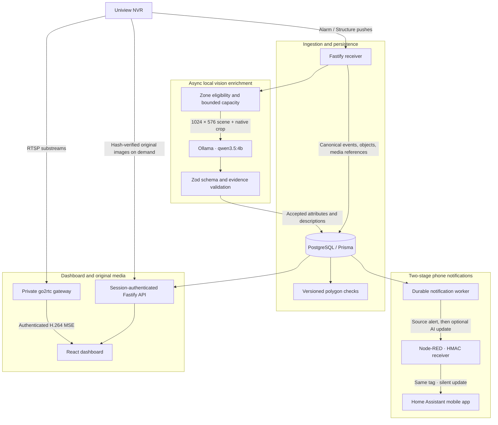

# Home Security

A self-hosted event pipeline, live-view dashboard and local vision-LLM enrichment system built around a Uniview NVR.

## Why I built it

My NVR reliably records video around the clock and reports detections. Finding a particular event, reviewing what happened and getting a useful phone alert were harder than they needed to be. I also wanted camera images to stay on my own hardware.

I built Home Security around the NVR: PostgreSQL indexes canonical detections, a React dashboard makes them searchable, and a local Ollama vision model adds descriptions. A private go2rtc gateway provides low-latency H.264 live views with the NVR's detection polygons overlaid. Home Assistant delivers an immediate source-based phone alert, then quietly updates that same notification when useful AI analysis arrives.

## Architecture



The receiver, API and notification worker run as separate processes. Capture commits the original detection independently of AI capacity and alert eligibility. Each canonical event keeps its NVR installation, channel, alarm type and RelatedID identity.

## Engineering decisions

### Keep original media on the NVR

I store image references and hashes alongside event metadata, then retrieve original scenes and object crops on demand. The image resolver checks source correspondence and hashes before serving media. A bounded browser RAM cache, request sharing and a bounded API queue make gallery navigation practical without a second snapshot archive.

### Put inference behind the first alert

The first notification uses NVR categories and source geometry. Ollama runs separately on a bounded inference slot; if the GPU is busy, the event and initial alert still work. Accepted analysis can replace the text of the existing Android notification using its stable tag and `alert_once`. The update has its own delivery identity and does not spend the rule's cooldown again.

### Version geometry, keep preferences local

The receiver reads camera names, stream profiles and EnterArea polygons at startup and every ten minutes. Geometry changes create new versions. Local display names, interest flags, AI eligibility and notification rules use stable camera/rule-slot identities, so a configuration refresh preserves them. Boundary and missing-coordinate cases stay explicit in the geometry engine.

### Make delivery recoverable

A PostgreSQL ledger records evaluation, cooldown reservations, delivery claims, attempts and receipts. Signed HMAC webhooks use pinned destinations, replay checks and stable idempotency keys. Retries are bounded, and uncertain network outcomes remain visible for investigation. Notification selection works from source metadata even when AI is skipped.

## Dashboard

- **Overview:** database aggregates, activity trends and recent detections.
- **Explore:** cursor-paginated events, London-time ranges, camera/category/zone filters, AI and notification outcomes, and original-image details.
- **Cameras:** live H.264 substreams, fullscreen viewing and synchronized polygon overlays.
- **Settings:** camera synchronization, zone preferences, independent AI and notification rules, webhook testing and delivery history.
- **Home Assistant:** a scoped REST summary and zone-history integration for detections and notification outcomes inside an existing dashboard.

## Stack

| Layer | Technology |
|---|---|
| API and receiver | Node.js 24, TypeScript, Fastify, Zod |
| Event index and ledger | PostgreSQL, Prisma |
| Dashboard | React, Vite, Tailwind CSS v4, shadcn/ui, TanStack Query, React Router |
| Local vision | Ollama, Qwen3.5 4B |
| Live video | go2rtc, authenticated H.264 MSE proxy |
| Mobile integration | HMAC webhooks, Node-RED, Home Assistant |
| Deployment | Docker Compose, Coolify, Traefik |

## Quickstart

Use Node.js 24, npm and Docker Compose. This starts an isolated development database and a read-only dashboard API; add NVR credentials when you want to browse real events.

```sh
npm ci
npm --prefix web ci
cp .env.example .env.local
chmod 600 .env.local
```

In `.env.local`, set `POSTGRES_PASSWORD` and the matching `DATABASE_URL` password. The example database hostname is `db`. Then:

```sh
docker compose --env-file .env.local -f docker-compose.dev.yml up -d db
docker compose --env-file .env.local -f docker-compose.dev.yml --profile tools run --rm migrate
```

Set `DEV_DATABASE_CONTAINER` in `.env.local` to the ID returned by:

```sh
docker compose --env-file .env.local -f docker-compose.dev.yml ps -q db
```

Prepare and start the dashboard:

```sh
npm run dev:setup
npm run dev
```

Open **http://127.0.0.1:5173** and use the generated password in `.env.dashboard.local`. A fresh database shows an empty event history. `Ctrl+C` stops Vite and the development API; `docker compose --env-file .env.local -f docker-compose.dev.yml stop db` stops the development database.

For LAN development, set `DEV_LAN_IP` in `.env.dashboard.local` and run `npm run dev:lan`. Open `https://<LAN_IP>:5173`; the launcher creates a local development certificate. All database, NVR, gateway and webhook credentials stay server-side.

Connecting a real NVR, enabling capture/AI and deploying the five-service production stack are covered in [Operations](docs/OPERATIONS.md). The Compose templates reuse external PostgreSQL and Ollama services and support Coolify/Traefik routing at a domain such as `https://security.example.com`.

## Verification

```sh
npm run check
npm --prefix web test
npm --prefix web run build
npm --prefix web run build:edge
```

The suites cover synthetic NVR payloads, canonical identity, geometric attribution, structured AI validation, authenticated media, notification retries/cooldowns and frontend behavior. CI runs these checks and a Git-history secret scan.

## Source map

| Path | Contents |
|---|---|
| [`src/`](src/) | API, receiver, NVR transport, geometry, AI and delivery worker |
| [`web/`](web/) | Dashboard, image request manager and production edge |
| [`prisma/`](prisma/) | Schema and migration history |
| [`tests/`](tests/) | Backend suites and synthetic fixtures |
| [`integrations/`](integrations/) | Home Assistant integration templates |
| [`deploy/`](deploy/) | Production gateway, worker and Coolify tooling |

## Hardware and integration scope

I run local vision on an AMD Radeon 780M through Ollama's Vulkan backend. The current capture adapter expects Uniview Alarm/Structure payloads and the matching original-image endpoints. Live viewing uses H.264 substreams; mobile alerts use the supplied Node-RED/Home Assistant contract. Adapting a different NVR means implementing its source identities, media references and payload mapping.
